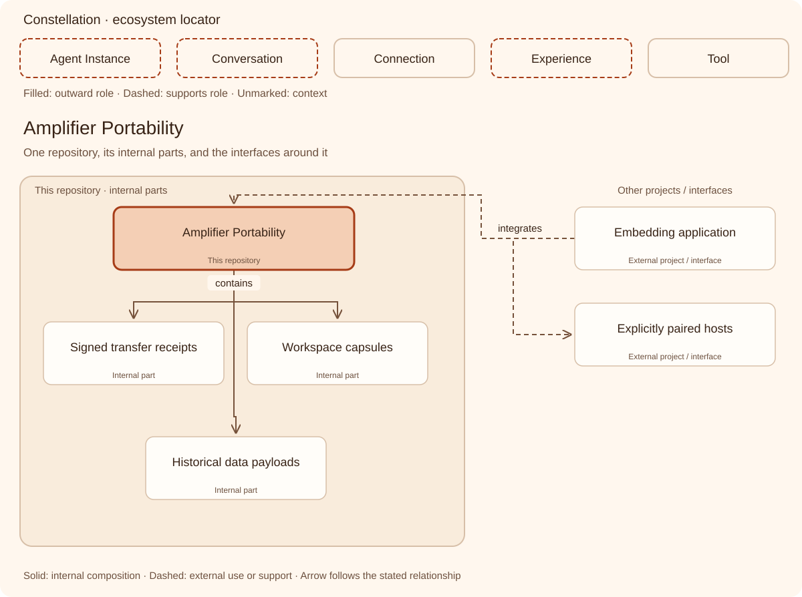

# Amplifier Portability

Python tools for moving selected work between explicitly paired hosts. The
library provides signed transfer receipts, workspace capsules, and verified
copies of selected historical data.

It is intended for applications implementing a reviewed handoff. The application
still controls host authentication, transport, user approval, and which runtime is
allowed to continue the work.

## Get started

Use Python 3.11 or later. From a checkout, install the package and its dependencies
in a virtual environment:

```sh
uv venv
uv pip install .
```

Create a durable local identity and receipt store in a private directory owned by
your application:

```python
from amplifier_portability import TransferNode

node = TransferNode('./.portability', label='my-host')
node.recover()
print(node.identity['id'])
```

Keep that directory private and persistent: it holds the host's signing key and
transfer records. Creating a node does not pair hosts, move files, or start an
agent. Follow the [transfer contract](docs/contract.v1.md) when connecting the
library to your application's trusted pairing and runtime controls.

Call `recover()` before admitting work after a restart. It marks interrupted
transfers unknown without replaying them. For an older JSON-only store, or damaged
lookup tables with intact write intent, this also prepares the index under the
existing store lock. No separate maintenance command is needed. Confirmed JSON
receipts remain unchanged; a healthy index avoids reading historical receipts.
Missing or unreadable write intent, or a pending write without its exact receipt,
still refuses recovery. Preserve that evidence and investigate the uncertainty;
deleting the database is not a repair.

The exact Worktrees input for this recovery qualification is recorded in
[`worktrees-source.json`](worktrees-source.json). Install that original
`amplifier-worktrees` 0.1.0 wheel when qualifying a consumer; a matching version
number alone does not establish source identity. This record preserves the
tested public dependency without narrowing the package's supported dependency
ranges. Consumers retain their own source selections and tighter constraints;
this record does not establish application adoption.

## Choose the part you need

- `TransferNode`: signed handoff records and queries for their current state.
- [Workspace capsules](src/amplifier_portability/capsule.py): capture and restore
  reviewed workspace changes against an exact source revision.
- [Owner evidence](src/amplifier_portability/evidence.py): preserve exact JSON
  bytes and explicit omissions across a transfer.
- [Historical payloads](docs/payload-contract.v1.md): copy selected attachment or
  resource bodies with size and digest verification.

Treat a capsule as data, not permission to execute its contents. Secret-pattern
checks cannot prove that arbitrary content is safe to share; review what you send. A missing or uncertain receipt must be inspected, not treated as
permission to repeat the transfer.

## Development

```sh
uv sync --group dev
uv run pytest
uv build
```

See the [integration contract](docs/contract.v1.md) for API responsibilities and
supported boundaries.


<!-- ecosystem-map:start -->
## Where this fits

A reusable transfer library under application-owned pairing, transport and execution policy.

Supports: Agent Instance, Conversation, Experience.



[Open the map](docs/ecosystem-map.svg) · [Product overview](https://microsoft.github.io/amplifier-constellation/projects/amplifier-portability/) · [Map guide](https://github.com/microsoft/amplifier-constellation/blob/main/docs/ecosystem-maps.md)

<details>
<summary>The five shared building blocks</summary>

[](https://microsoft.github.io/amplifier-constellation/)

</details>

<!-- ecosystem-map:end -->

## Immutable package delivery

The package workflow builds an exact reviewed revision, verifies the wheel and
source archive against Git, and tests the installed package outside the checkout.
Its focused checks cover retained receipt recovery, exclusive execution ownership,
workspace capsules and historical payloads. The existing complete compatibility
suite remains separate; package checks are not live-host acceptance.

For an accepted commit, the manual workflow may publish the four original assets
under `portability-v<version>`: wheel, source archive, `portability-source.json`
and `SHA256SUMS`. The receipt binds the full repository revision/tree and exact
package inputs, preserving `src/amplifier_portability` source paths and the
`amplifier_portability` installed namespace. Version 0.1.3 identifies this recovery
successor; historical qualification and artifacts retain their original bytes.

Installed qualification uses the original public Worktrees artifact named in
`worktrees-source.json`, verifying its receipt and bytes before installation.
This does not narrow public dependency ranges or change a consumer's selection.
Do not co-install this distribution with Unified while Unified owns the same
import; its artifact selection, tighter dependency constraints and assembly remain
separate consumer responsibilities.

Publication never moves an existing tag or overwrites an asset. After a lost
reply, inspect the exact tag/release ID and original bytes before continuing.
Only matching original assets may resume a draft; never rebuild different bytes
under an existing tag. No workflow run or source acceptance automatically
publishes a package or adopts it in an application.

## Contributing

Most contributions require you to agree to a
Contributor License Agreement (CLA) declaring that you have the right to, and actually do, grant us
the rights to use your contribution. For details, visit [Contributor License Agreements](https://cla.opensource.microsoft.com).

When you submit a pull request, a CLA bot will automatically determine whether you need to provide
a CLA and decorate the PR appropriately (e.g., status check, comment). Simply follow the instructions
provided by the bot. You will only need to do this once across all repos using our CLA.

This project has adopted the [Microsoft Open Source Code of Conduct](https://opensource.microsoft.com/codeofconduct/).
For more information see the [Code of Conduct FAQ](https://opensource.microsoft.com/codeofconduct/faq/) or
contact [opencode@microsoft.com](mailto:opencode@microsoft.com) with any additional questions or comments.

## Trademarks

This project may contain trademarks or logos for projects, products, or services. Authorized use of Microsoft
trademarks or logos is subject to and must follow
[Microsoft's Trademark & Brand Guidelines](https://www.microsoft.com/legal/intellectualproperty/trademarks/usage/general).
Use of Microsoft trademarks or logos in modified versions of this project must not cause confusion or imply Microsoft sponsorship.
Any use of third-party trademarks or logos are subject to those third-party's policies.
